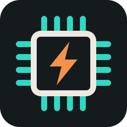
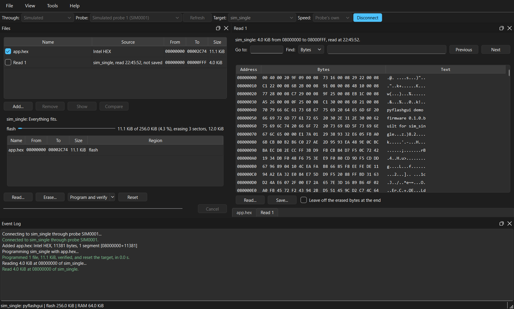

<p align="center">
  
</p>

# pyflashgui

[](https://github.com/davhodg/pyflashgui/actions/workflows/ci.yml)
[](https://github.com/davhodg/pyflashgui/releases)
[](https://pypi.org/project/pyflashgui/)


A graphical flash programming tool. It works with any debug probe [pyOCD](https://pyocd.io) supports, for Arm Cortex-M targets: CMSIS-DAP probes such as the Raspberry Pi Debug Probe, DAPLink, NXP MCU-Link and Atmel-ICE, TI XDS110 and the probes built into many development boards, as well as ST-Link and J-Link. With a J-Link it can also use SEGGER's J-Link Commander, for the many other devices that supports.



## What it is for

**It is a tool for the bench**: for development, debugging and hobby use. It is not meant for production programming.

- **Any probe.** A low-cost CMSIS-DAP probe or the ST-Link on a development board does the job a dedicated programmer does.
- **Workspaces.** The target, the probe, its speed and the files to program are kept together, one workspace per product, so programming a board is one click.
- **Files.** ELF, Intel HEX, Motorola S-record and raw binary, with a map of what will be written where, and what is read back from a target in the same list, to compare and save.
- **Device packs.** Every Cortex-M device there is a CMSIS-Pack for, found by part number and installed from inside pyflashgui -- or from a file, for a computer with no internet.
- **Python.** A console with the probe and the target to hand, and *File > Run script...*, for what the buttons do not do: watching a value in RAM, writing a test pattern, a loop that programs and reads back.

## Installing

There are three options:

1. **With pip** -- from [PyPI](https://pypi.org/project/pyflashgui/), into whichever Python environment you choose. Python 3.12 or newer is needed.

   **Python 3.15 on Windows is not supported yet:** libraries pyOCD needs there have not been released for 3.15. Use 3.14, 3.13 or 3.12 until they have.

   To install it:

   ```
   pip install pyflashgui
   ```

   To run it:

   ```
   pyflashgui
   ```

   To update it:

   ```
   pip install --upgrade pyflashgui
   ```

   It is an ordinary Python package with an ordinary entry point, so the choice of environment is yours.

   On Linux, Qt needs one system library first: see *On Linux* below.

2. **The Windows installer** -- `pyflashgui-<version>-setup.exe` from the [releases page](https://github.com/davhodg/pyflashgui/releases). Nothing else is needed: **not even Python.** It installs a self-contained application, offers a desktop shortcut, and uninstalls cleanly. This is the one for somebody who wants a flash programming tool rather than a Python package.

   It asks first who it is for: **everybody who uses the computer**, which needs administrator rights, or **only you**, which does not.

3. **From a Git clone** -- clone the repository, then double-click `pyflashgui.cmd` (Windows) or run `./pyflashgui.sh` (Linux). This is the way to have the latest changes before they are released, or to contribute. Python 3.12 or newer is needed: on Windows 3.14, 3.13 or 3.12, as below.

   The first run sets itself up: it creates a *virtual environment* -- a folder called `.venv` holding its own copy of Python and only the libraries pyflashgui needs, so nothing else on the machine is touched -- and downloads a couple of hundred megabytes into it. That takes a few minutes once; every later start is immediate, and deleting `.venv` undoes the whole thing. If `uv` is installed it is used instead of pip, which makes rebuilding that folder a matter of seconds.

   **On Windows** the launcher makes `.venv` from Python 3.14, 3.13 or 3.12 when the `py` launcher has one of them, newest first, even if a newer Python is the one on the PATH: those are the versions every library pyflashgui runs on has a ready-made download for. 3.15 is not one of them yet; if it is the only Python installed, `py install 3.14` adds one the launcher will choose.

   **If the Python `.venv` was made with is uninstalled** -- or replaced by a newer version -- the launcher says so, and offers to delete `.venv` and set it up again with the Python installed now. Workspaces and settings are not in `.venv`, and are kept.

   **On Linux**, run it from a terminal, so its messages can be read:

   ```
   ./pyflashgui.sh
   ```

   Debian, Ubuntu, Linux Mint and the like often leave out the package that lets Python create `.venv`. The launcher names it if it is missing:

   ```
   sudo apt install python3-venv
   ```

   Double-clicking `pyflashgui.sh` in a file manager works too: choose *Run in Terminal* when it asks, for the same reason.

   For a shortcut, *Tools > Settings > Add shortcut to Start menu* (the applications menu on Linux) and, on Windows, *Add shortcut to desktop*. The entry starts the launcher, so a start from it after a pull still picks up new libraries.

   The launcher keeps its own `.venv` on purpose and will not use an environment you already have. That is the point of it: it is the way in for somebody who does not want to think about Python environments, and one that sometimes used yours and sometimes did not would be worse than one that never does. To run a checkout in an environment of your own instead, `pip install -e .` installs it there, reading the source.

**On Linux**, however pyflashgui is installed -- with pip or from a clone -- Qt needs a system library to draw the window, and Debian, Ubuntu, Linux Mint and the like often leave it out:

```
sudo apt install libxcb-cursor0
```

Without it pyflashgui stops as it starts, naming the package that is missing.

**Where your own files are kept** is the same whichever way it was installed: your workspaces and settings are in `%APPDATA%\pyflashgui` on Windows and `~/.config/pyflashgui` on Linux. Upgrading and uninstalling leave that folder alone.

## Probes

Every probe is reached through [pyOCD](https://pyocd.io), which has a driver for each of the ways a probe talks over USB. Which probes work is therefore pyOCD's list:

| Probe | How pyOCD talks to it | What to install | Worth knowing |
|---|---|---|---|
| **CMSIS-DAP probes** | Arm's open CMSIS-DAP protocol | Windows: nothing. Linux: a udev rule. | The widest choice, and the one to pick when there is a choice. |
| **ST-Link** v2, v2-1 and v3 | ST's own protocol | Windows: ST's USB driver, where Windows has none for it. Linux: a udev rule. | Recent ST-Link firmware reaches only STM32 targets: for any other maker's device, use another probe. Firmware V2J24 or newer. |
| **J-Link** | SEGGER's own library, or CMSIS-DAP for a J-Link switched to that mode | SEGGER's J-Link software, on Windows and on Linux. | In its own mode it is not offered until that software is installed. Current J-Link BASE, PLUS, EDU, ULTRA+ and PRO models can be set to start as a CMSIS-DAP probe instead, with SEGGER's Configurator, and are then used like any other. |
| **Picoprobe** | The original Raspberry Pi Pico probe firmware | Linux: a udev rule. | The Pico's current debug probe firmware is CMSIS-DAP instead, and is the one to have. |

CMSIS-DAP is a protocol and not a product, so a great many probes speak it. Among those pyOCD's documentation names:

- Raspberry Pi Debug Probe, and a Pico running the debug probe firmware
- DAPLink, on its own and built into Arm Mbed and micro:bit boards
- NXP MCU-Link, MCU-Link Pro, LPC-Link2 and OpenSDA
- Microchip Atmel-ICE, and the EDBG on Microchip's boards
- Infineon (Cypress) KitProg3 and MiniProg4
- Keil ULINKplus
- TI XDS110, standalone and on TI LaunchPads. It is asked for one reply at a time, which some versions of its firmware need; pyflashgui sets that itself. pyOCD's udev rules do not include it, so on Linux it wants a rule of its own or the one TI's software installs.

**With pyOCD, the target has to be an Arm Cortex-M, whichever probe it is.** The probe carries the debug port; what is on the far side of it is pyOCD's to understand, and Cortex-M is what it understands. A probe that can reach other kinds of processor with its maker's own software -- a Cortex-A or Cortex-R, a RISC-V core -- still reaches only Cortex-M here.

**Which Cortex-M devices** is a matter of CMSIS-Packs. pyOCD has a few dozen devices built in; every other is described by a pack its maker publishes. **Tools > pyOCD device packs** finds a device by its part number and downloads the pack it is in, however pyflashgui was installed.

### Beyond Cortex-M, with a J-Link

pyflashgui can instead drive a J-Link through SEGGER's own J-Link Commander, which comes with SEGGER's J-Link software. That reaches every device SEGGER's software knows -- Cortex-A and Cortex-R, RISC-V and others -- and works with a J-Link and nothing else. SEGGER's software is yours to install, under SEGGER's licence: it is for genuine SEGGER probes, and SEGGER describes J-Link Commander as a tool for development, not for production programming.

On Linux a probe is usable without root once a udev rule allows it; pyOCD publishes [a set of them](https://github.com/pyocd/pyOCD/tree/main/udev). Vendor software is never bundled with pyflashgui: install the vendor's own, and pyflashgui finds it.

## Built with

| Package | For | Licence |
|---|---|---|
| [PySide6](https://www.qt.io/qt-for-python) (Essentials) | the windows | LGPL-3.0 |
| [pyOCD](https://pyocd.io) | probes, targets and flash algorithms | Apache-2.0 |
| [bincopy](https://github.com/eerimoq/bincopy) | Intel HEX, S-record and binary files | MIT |

## Uninstalling

- **The Windows installer:** *Settings > Apps* (or *Add or remove programs*), or *Uninstall
  pyflashgui* in its Start menu folder. It takes away its shortcuts too.
- **pip:** `pip uninstall pyflashgui`, and what *Tools > Settings* added, as for a clone.
- **A Git clone:** delete the folder. If *Tools > Settings* was used to add a shortcut, take
  that away as well: the shortcuts are
  `%APPDATA%\Microsoft\Windows\Start Menu\Programs\pyflashgui.lnk` and `pyflashgui.lnk` on
  the desktop (on Linux, `~/.local/share/applications/pyflashgui.desktop`).

Your workspaces and settings are in `%APPDATA%\pyflashgui` (`~/.config/pyflashgui` on Linux),
and no way of uninstalling touches them; delete that folder to remove them too.

## Contributing

See [CONTRIBUTING.md](CONTRIBUTING.md): the policy for changes, setting up to work on pyflashgui, running the tests, and building the Windows installer. Everyone taking part is asked to follow the [code of conduct](CODE_OF_CONDUCT.md). Security problems go through [SECURITY.md](SECURITY.md).

## Safety notice

pyflashgui talks to real equipment. It is intended only for people trained and experienced in working with microcontrollers, debug probes and the equipment they are part of. It is a tool for development and the bench, and is not meant for production programming.

Erasing and programming replace what a device holds, and cannot be undone. A device given the wrong file, or one that changes its protection or configuration, may not run, and may no longer be reachable through its debug port. Connecting, resetting and reading can stop or restart a device that is running, and with it whatever that device controls.

Like any software, pyflashgui can have faults, so do not rely on it alone to say that a device holds what was meant. Where a mistake could hurt someone or damage equipment, keep a way to stop that equipment within reach.

## Licence

pyflashgui is free software, provided under the Apache License 2.0, without warranty of any kind; see [LICENSE](LICENSE) and [NOTICE](NOTICE).

Development has made use of Anthropic's Claude.
